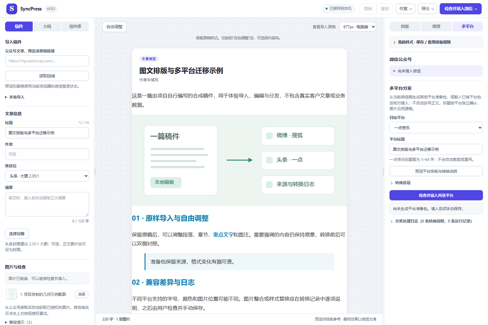

# SyncPress｜跨平台富文本排版与分发器

你写好了一篇文章，想发到微博、搜狐、头条等平台。复制过去以后，字号变了、段落挤在一起、图片位置也乱了。

**SyncPress 帮你整理这次“搬家”：先保留原稿，再按不同平台调整格式，让你看清改了什么，最后由你检查并保存。**

它是一个 Chrome / Edge 浏览器扩展，此源码版本为 **v1.0.1**。

## 它能帮我做什么？

- **把文章带进来**：导入 HTML、Markdown、TXT、本地文章文件夹，或读取你能访问的公众号文章。
- **在本机改一改**：修改文字、移动章节、调整字号和间距，也能使用格式刷、图注和常用组件。
- **换个平台试试看**：选择目标平台，对照原稿与转换结果，查看每一处格式变化。
- **把文章带出去**：下载准备包，或者在你选择的空白编辑页中填入文章与配图。

“富文本”就是带有**粗体、字号、颜色、图片和段落样式**的文字。你不需要会写代码。

## 第一次用，怎么安装？

普通使用不需要 Node.js、API Key 或另外启动一个服务。

1. 打开 [最新版下载页](https://github.com/cerveth07/draft-helper/releases/latest)。
2. 下载文件名以 **`extension.zip`** 结尾的扩展包，并解压。
3. Chrome 打开 `chrome://extensions`；Edge 打开 `edge://extensions`。
4. 开启“开发者模式”，点击“加载已解压的扩展程序”。
5. 选择解压后**包含 `manifest.json` 的文件夹**。
6. 点击浏览器工具栏里的 SyncPress 图标，再点“打开排版工作台”。

如果下载的是整个源码包，第 5 步请选择源码中的 **`extension/`** 文件夹。

## 从一篇文章开始

### 1. 放入文章

粘贴公众号文章、预览或草稿链接，点击「读取链接」。如果该链接已经在浏览器中打开，扩展会直接读取原页面。导入时一并带入来源页提供的摘要。

展开「本地导入」可选择文章文件、粘贴内容，或载入包含正文和配图的文件夹及解压后的微信、平台准备包。

想先试用：点击工作台的「打开示例」；也可以用仓库里的 [自制示例](examples/README.md)。

### 2. 检查和编辑

点击「查看导入原稿」对照内容。需要改字、编排章节或调整样式时，点击「自由调整」。顶栏「恢复」可以恢复原正文与排版，或恢复整篇原稿。

补齐缺失的图片，填写标题、作者、摘要和封面。工作稿会保存在本机，关闭页面前请等到“已保存到本机”。

### 3. 选择发布平台

在“多平台分发”中选择平台，再检查该平台的标题和封面。微博还有一项可选的短导语，和原文摘要分开填写。

点击“预览平台排版与转换说明”，看看原稿与平台稿有哪些区别。

### 4. 导出，或者填入编辑页

顶栏「导出」可选择 HTML、微信准备包或当前目标平台的准备包。

- 想稍后继续：下载准备包，留在本机备用。
- 想填到平台：先登录平台并打开一篇**空白文章**。点击「填入」后，选择自动列出的目标编辑页，再确认填入。

填入会上传图片并填写内容。**保存和发布由你在平台完成**；有的平台编辑器本身可能自动暂存草稿，请留意平台提示。

## “准备包”是什么？

把它想成文章的一个文件袋，里面装着标题、正文、配图和处理记录。

你可以用它备份，也可以以后重新导入。重新选择准备包时，先解压，再选择包含 `manifest.json` 的整个目录。

包里还保留原稿和来源记录。发现转换结果不合适时，可以回去检查原文。

## 格式能完全一样吗？

不同平台能接收的格式不一样，SyncPress 会分开处理：

| 原稿中的内容 | 通常怎样处理 |
| --- | --- |
| 平台支持的文字、图片和段落格式 | 尽量保留，并在填入后核对 |
| 平台不支持的彩色强调、字号或间距 | 换成平台能保存的格式，逐项写入转换说明 |
| 难以直接复制的并排图文、叠层等布局 | 可能把局部整合成图片，并保留原稿 |
| 平台会放大的装饰小图等内容 | 按平台规则处理，并记录省略的位置与原因 |

**转成图片的文字，无法在目标平台逐字编辑。** 工作台会注明转换范围。动图也不会被工具悄悄改成单帧；遇到无法处理的内容时会提示你。

因此，发布前仍要到目标平台检查一次，尤其是图片、封面和复杂排版。

## 可以发到哪些平台？

支持微信公众号、微博头条文章、搜狐号、今日头条和一点号的准备包与编辑页填入；企鹅号提供基础适配。

平台更新后，页面入口或格式规则可能变化。如果提示不兼容，请先检查转换说明和当前平台编辑页。

## 文章存在哪里？

工作稿、素材和组件收藏保存在你的本机浏览器中；下载的准备包由你自己保存。

读取文章、下载图片和填入平台时，会访问相应站点。更详细的说明见 [隐私与权限](PRIVACY.md)。卸载或清除扩展数据前，记得导出要保留的稿件。

## 遇到问题怎么办？

- **图片没有进来**：检查本地文件夹是否带齐配图；远程图片可能需要授权下载或手动补图。
- **样式变了**：先看“预览平台排版与转换说明”，再到平台检查实际效果。
- **拒绝填入已有正文**：换一篇空白文章，避免覆盖旧稿。
- **更新后没有变化**：在扩展管理页点击“重新加载”，再重新打开工作台。

仍有问题，可以提交 [Issue](https://github.com/cerveth07/draft-helper/issues)。请说明版本和操作步骤，并去掉账号凭证、私密链接和未公开稿件。

## 开源与开发

本项目采用 [MIT 许可证](LICENSE)。第三方声明见 [THIRD_PARTY_NOTICES.md](THIRD_PARTY_NOTICES.md)；你自己导入的文章和图片，仍需拥有相应使用权。

开发者可以继续阅读 [贡献指南](CONTRIBUTING.md)、[准备包格式](docs/packages.md)、[代码结构](docs/architecture.md) 和 [安全反馈](SECURITY.md)。
